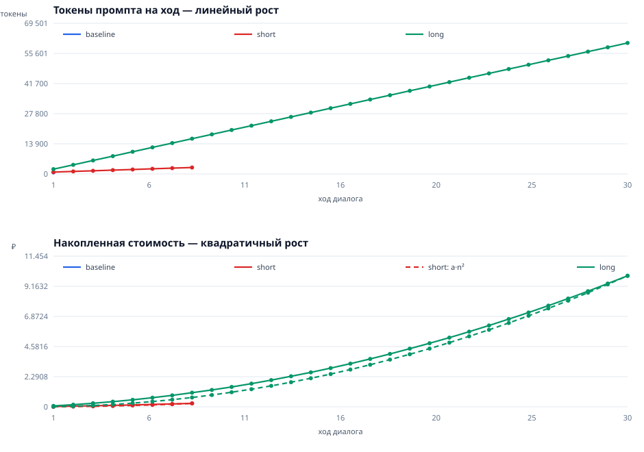

# Как растут токены и стоимость диалога

- режим: **stub**
- запуск: 2026-11-14T12:54:57
- потрачено: **10.23 ₽** из капа 45.0 ₽
- модель цены: вход 9 ₽/1M, выход 100 ₽/1M, накладные 700 токенов на вызов
- заявленный лимит контекста: 1 000 000 токенов

> Режим `stub`: модель заменена заглушкой, которая считает токены тем же локальным счётчиком и имитирует лимит контекста. Маршруты, хранилище и обработка ошибок — настоящий код приложения. Пайплайн проверяется бесплатно; реальные цифры даст режим `real`.

## Сводка по сценариям

| сценарий | ходов | промпт 1-го хода | пик промпта | вход всего | выход всего | стоимость, ₽ | статус |
|---|---|---|---|---|---|---|---|
| baseline | 1 | 711 | 711 | 711 | 50 | 0.01 | ok |
| short | 8 | 852 | 2 980 | 15 328 | 1 200 | 0.26 | ok |
| long | 30 | 2 204 | 60 436 | 939 600 | 15 000 | 9.96 | ok |
| overflow | 0 | 0 | 0 | 0 | 0 | 0 | failed |

- **Нулевой замер** — пустая история и минимальное сообщение: сколько стоит сам запрос
- **Короткий диалог** — 8 ходов по ~150 токенов: рост есть, но суммарно копейки
- **Длинный диалог** — история растёт на ~2000 токенов за ход: видно квадратичную стоимость
- **Переполнение лимита** — история засеяна выше лимита: смотрим, что именно ломается

## Короткий диалог: все ходы

| ход | история | запрос | промпт (API) | ответ | цена, ₽ | накоплено, ₽ | сек |
|---|---|---|---|---|---|---|---|
| 1 | 0 | 148 | 852 | 148 | 0.02 | 0.02 | 0.01 |
| 2 | 304 | 148 | 1 156 | 148 | 0.03 | 0.05 | 0.01 |
| 3 | 608 | 148 | 1 460 | 148 | 0.03 | 0.08 | 0.01 |
| 4 | 912 | 148 | 1 764 | 148 | 0.03 | 0.11 | 0.01 |
| 5 | 1 216 | 148 | 2 068 | 148 | 0.03 | 0.14 | 0.01 |
| 6 | 1 520 | 148 | 2 372 | 148 | 0.04 | 0.18 | 0.01 |
| 7 | 1 824 | 148 | 2 676 | 148 | 0.04 | 0.22 | 0.01 |
| 8 | 2 128 | 148 | 2 980 | 148 | 0.04 | 0.26 | 0.01 |

## Длинный диалог: каждый пятый ход

| ход | история | запрос | промпт (API) | цена, ₽ | накоплено, ₽ | сек |
|---|---|---|---|---|---|---|
| 5 | 8 032 | 1 500 | 10 236 | 0.14 | 0.53 | 0.02 |
| 10 | 18 072 | 1 500 | 20 276 | 0.23 | 1.51 | 0.03 |
| 15 | 28 112 | 1 500 | 30 316 | 0.32 | 2.94 | 0.03 |
| 20 | 38 152 | 1 500 | 40 356 | 0.41 | 4.83 | 0.04 |
| 25 | 48 192 | 1 500 | 50 396 | 0.5 | 7.17 | 0.05 |
| 30 | 58 232 | 1 500 | 60 436 | 0.59 | 9.96 | 0.05 |

### Проверка квадратичности

Стоимость на ходе 15: **2.94 ₽**, на ходе 30: **9.96 ₽** — отношение **3.39**.
При чисто квадратичном росте удвоение числа ходов даёт ×4; постоянная добавка на накладные расходы слегка занижает это число. Промпт первого хода 2 204 токенов, последнего — 60 436.

## Переполнение: что ломается

История засеяна напрямую в SQLite: 1 050 000 токенов (105 сообщений), лимит 1 000 000.

| ход | статус | HTTP | история | сообщений в БД | ошибка |
|---|---|---|---|---|---|
| 1 | error | 200 | 1 050 420 | 105 | This model's maximum context length is 1000000 tokens. However, you requested 1051323 tokens (1051323 in the messages). Please reduce the length of the messages. |
| 2 | error | 200 | 1 050 420 | 105 | This model's maximum context length is 1000000 tokens. However, you requested 1051323 tokens (1051323 in the messages). Please reduce the length of the messages. |
| 3 | error | 200 | 1 050 420 | 105 | This model's maximum context length is 1000000 tokens. However, you requested 1051323 tokens (1051323 in the messages). Please reduce the length of the messages. |

Что из этого следует:

- `/api/chat` отвечает **HTTP 200** — ошибка отдаётся как успех, отличить отказ на уровне транспорта нельзя;
- в базе 105 сообщений до и 105 после: упавший ход **не сохранён**, UI и БД расходятся;
- попыток подряд: 3 — каждая падает одинаково, потому что история не обрезается: **диалог заклинило**, лечится только «Сбросить».

Текст ошибки, который видит пользователь:

```
This model's maximum context length is 1000000 tokens. However, you requested 1051323 tokens (1051323 in the messages). Please reduce the length of the messages.
```

## График



Верхняя панель — токены промпта на каждый ход: линейный рост. Нижняя — накопленная стоимость: квадратичный. Пунктиром наложена модель `a·n²`, построенная по последней точке: совпадение означает, что рост объясняется именно повторной отправкой всей истории.

## Выводы

1. **Плата за ход пропорциональна длине истории, а плата за диалог — квадрату числа ходов.** Каждый ход отправляет всю переписку заново, поэтому `Σ ≈ k·n²/2` входных токенов.
2. **Постоянная добавка.** Даже пустой диалог стоит ~711 токенов на запрос (по данным нулевого замера): схемы инструментов и обвязка. Локальный счётчик её не видит, поэтому предохранитель по локальным токенам будет ошибаться.
3. **Переполнение заклинивает диалог.** История только дописывается, обрезки нет: следующее сообщение снова отправит ту же переросшую историю и снова упадёт.
4. **Упавший ход не сохраняется.** `save_messages` вызывается только на успешном пути, поэтому UI и БД расходятся, а результаты уже выполненных инструментов теряются.
5. **Ошибка отдаётся с HTTP 200** (`/api/chat` ловит исключение и кладёт текст в поле `error`), поэтому отличить успех от отказа на уровне транспорта нельзя.
